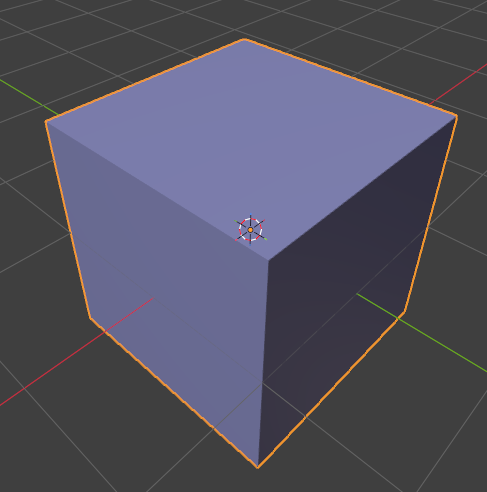
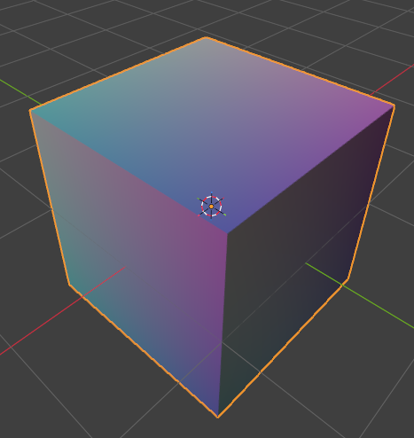
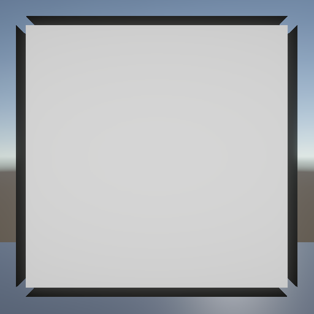
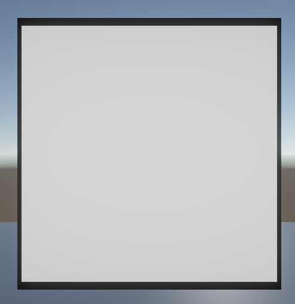

# Tangent Space Smooth Normal Baker

**English** | [简体中文](README.zh-CN.md)

A Blender addon designed to compute smooth normals, encode them into tangent space, and bake them directly into vertex colors. It supports outline masks and FBX export, with the calculated data primarily used to achieve inverted-hull outline effects in game engines.

The figures below demonstrate how normal data is represented in vertex colors under different baking methods (demonstrated using Blender 5.2.3 LTS):

| Default Normal Baking | Smooth Normal Baking via Addon |
|---|---|
|  |  |

The figures below show the outline effects produced in Unity Engine by an outline shader utilizing the two sets of normal data above:

| Outline with Default Normals | Outline with Smooth Normals |
|---|---|
|  |  |

## Getting the Addon
Download the `.py` script from the repository -> Open Blender Preferences -> Select "Install from Disk..." -> Choose the downloaded `.py` script.

## Core Features
This addon is an outline tool tailored specifically for NPR (Non-Photorealistic Rendering) workflows. By calculating an additional set of smoothed normals in Blender, game engines can leverage this data to generate outlines, resolving the issue of outline splitting and breaks at sharp corners and hard edges. The core features are as follows:

1. **Spatial Position Clustering & Smooth Normal Generation**
- **Position Welding:** Automatically groups and welds spatially coincident vertices across UV seams, hard edges, and multi-face corners, eliminating outline splitting and crevices caused by UV boundaries.
- **Angle Weighting:** Computes normal weights based on the interior angles of triangle corners, preventing normal skewing caused by irregular mesh topology.
- **Hemisphere Alignment:** Automatically aligns flipped or opposing triangle face normals into the same hemisphere before blending, avoiding surface artifacts and broken geometry caused by severe normal inversion.

2. **Tangent Space Storage & Standard Encoding**
- Smooth normals are stored in tangent space, enabling rigged/skinned skeletal meshes to maintain accurate outline rendering during animation. In game engines, use the TBN matrix to transform smooth normals from tangent space to other spaces (e.g., Object Space or World Space).
- The **RGB channels** of the vertex color store the tangent space normal data, encoded and compressed from `[-1, 1]` to `[0, 1]` (requiring decoding in the engine). The **Alpha (A) channel** stores the outline mask to control suppressed areas and outline thickness, which can be hand-painted.

3. **Overlap Mask Detection**
- Performs proximity and overlap detection in areas where multi-layered meshes are in close contact, using smoothstep transitions to fade out or eliminate outlines in tight crevices, preventing outline clipping and visual artifacts.

4. **FBX Export**
- Provides a fast and integrated FBX export feature.

## Workflow
1. Press `N` to open the sidebar, locate the **Normal Baker** tab, and select your mesh (the mesh must be triangulated; otherwise, an error will be reported).
2. Ensure the mesh has an active UV layer.
3. *(Optional)* Prepare an outline mask and enter the mask's attribute name into **Mask Attribute**.
4. Configure parameters (usually keep default; if no custom mask exists, the addon will automatically create a default mask):
- **Normal Attribute**: Target vertex color attribute name
- **Mask Attribute**: Custom mask attribute name
- **Preserve Existing Mask**: Keep checked to read hand-painted masks
- **Suppress Overlaps**: Keep checked to enable overlap proximity detection
- Fine-tune **Overlap Distance** (distance for complete outline suppression, default 3mm) and **Fade Distance** (distance to fade back to full width, default 10mm) based on your character's scale
5. *(Optional)* If you need a quick FBX export after baking, configure the export options.
6. Click **Bake Tangent Space Normals**.

## How to Retrieve Vertex Color Data in Engine (Unity Engine URP Example, Basic Usage)
In the Vertex Shader:
```hlsl
float3 smoothNormalTS = normalize(v.color.rgb * 2.0 - 1.0); // Retrieve smooth normal in tangent space from vertex color and decode

// Construct TBN matrix
float3 normalWS = TransformObjectToWorldNormal(v.normal);
float3 tangentWS = TransformObjectToWorldDir(v.tangent.xyz);
float sign = v.tangent.w * unity_WorldTransformParams.w;
float3 bitanWS = cross(normalWS, tangentWS) * sign;
float3 smoothNormalWS = normalize(
        tangentWS * smoothNormalTS.x + 
        bitanWS   * smoothNormalTS.y + 
        normalWS  * smoothNormalTS.z
    ); // Transform smooth normal from tangent space to world space (World space TBN * Tangent space normal vector)

// Channel A is the outline mask: 0 = no outline, 1 = full outline
float outlineMask = saturate(v.color.a);
```
## Supported Blender Versions
This addon supports Blender 3.6 LTS, 4.x, and 5.x.