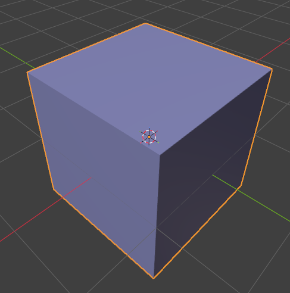
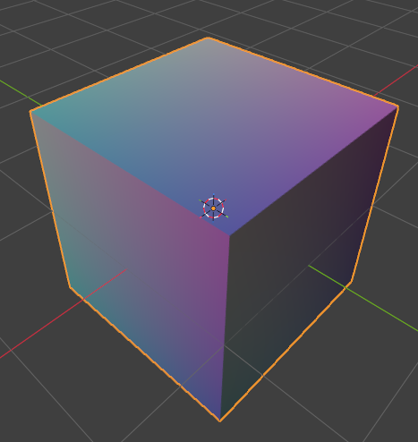
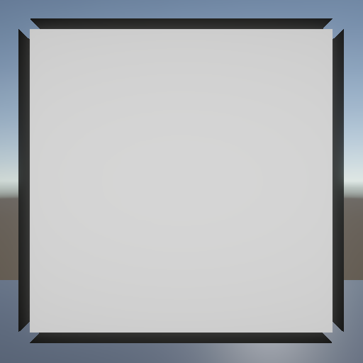
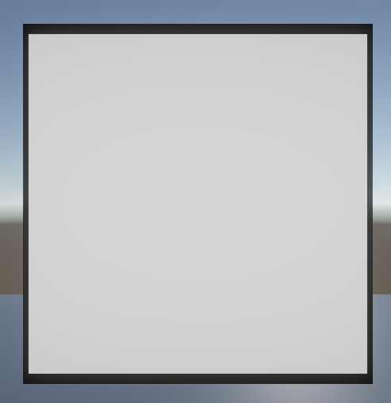

# 切线空间的平滑法线烘焙器

[English](README.md) | **简体中文**

一个用来计算模型平滑法线并在切线空间中编码以及将其烘焙到顶点色的Blender插件，支持outline遮罩和导出FBX,计算数据主要用于引擎中的描边效果实现。

下图展示了不同的烘焙方式下法线数据在顶点色上的表达(使用Blender5.2.3LTS进行演示)
| 原始的法线烘焙 | 使用插件的平滑法线烘焙 |
|---|---|
|  |  |

下图展示了在Unity Engine中，物体描边shader使用上图两种法线数据处理分别得到的描边效果

| 使用原始法线描边 | 使用平滑法线描边 |
|---|---|
|  |  |

## 获取插件
在仓库下载.py脚本--打开Blender偏好设置--选择从磁盘安装--选择下载好的.py脚本

## 核心功能
该插件是专为NPR渲染定制的外描边工具，通过在blender中额外计算出一套模型的平滑法线，游戏引擎可以借助这套平滑法线来实现外描边，一定程度上解决了物体尖锐部分描边发生断裂的问题。插件的核心功能如下：
1. 空间坐标聚类与平滑法线生成
- 空间焊接：自动对空间位置重合但UV缝合边断开、硬边拆分、多边角点处的断裂顶点进行归类与聚类焊接，消解因UV分割导致的描边分叉与裂口。
- 角度加权：依据三角形角点内角计算法线加权，消除不规则布线造成的描边法线偏斜。
- 半球面对齐：自动将折角/反向三角面的法向对齐至同一半球面后混合，防止法向剧烈翻转产生破面。

2. 切线空间存储和标准编码
- 将平滑法线存入切线空间，使得带骨骼的模型也可以得到准确的描边效果，在引擎中使用时，使用TBN矩阵将平滑法线从切线空间中转换到其他空间。
- 使用顶点色的RGB通道存放切线空间的法线数据，从[-1,1]编码压缩到[0,1]，在引擎中使用需要通过公式解码，顶点色的A通道存放描边遮罩，用来控制不需要描边的区域和描边的粗细，遮罩需要人工手动绘制。

3. 重叠遮罩检测
- 在多层网格紧贴的区域进行重叠检测，使用平滑过渡削弱或消除缝隙处描边，避免描边穿模。

4. FBX导出
- 提供快捷的FBX导出功能。

## 操作流程
1. 快捷键N展开侧栏，找到Normal Baker选项卡，选中网格，网格必须是三角面，不然会报错。
2. 检查是否有UV。
3. (可选项)准备描边遮罩，并键入遮罩名称到Mask Attribute。
4. 配置参数(通常默认，无自定义遮罩时插件会自动创建默认的遮罩)：
- Normal Attribute: 目标顶点色属性名
- Mask Attribute: 自定义遮罩名称
- Preserve Existing Mask: 保持勾选，以读取手绘的遮罩
- Suppress Overlaps保持勾选，开启重叠检测
- 根据角色尺寸微调Overlap Distance（完全消边距离，默认3mm）和Fade Distance（淡出恢复距离，默认10mm）
5. (可选项)如果要快捷导出FBX，可选择导出选项
6. 开始烘焙

## 如何在引擎中获取顶点色中的数据(以Unity Engine URP为例，基础用法)
在顶点着色器中
``` hlsl
float3 smoothNormalTS=normalize(v.color.rgb*2.0-1.0);   //从顶点色拿到切空间的平滑法线并解码
                 
//构造TBN矩阵
float3 normalWS=TransformObjectToWorldNormal(v.normal);
float3 tangentWS=TransformObjectToWorldDir(v.tangent.xyz);
float sign=v.tangent.w*unity_WorldTransformParams.w;
float3 bitanWS=cross(normalWS,tangentWS)*sign;
float3 smoothNormalWS = normalize(
        tangentWS * smoothNormalTS.x + 
        bitanWS   * smoothNormalTS.y + 
        normalWS  * smoothNormalTS.z
    );//将平滑法线从切空间转换到世界空间(世界空间下的TBN*切空间法向量)

// A 通道为描边遮罩：0 不描边，1 完整描边
float outlineMask = saturate(v.color.a);
```
## 适配版本
该插件适配Blender3.6 LTS、4.x、5.x。


